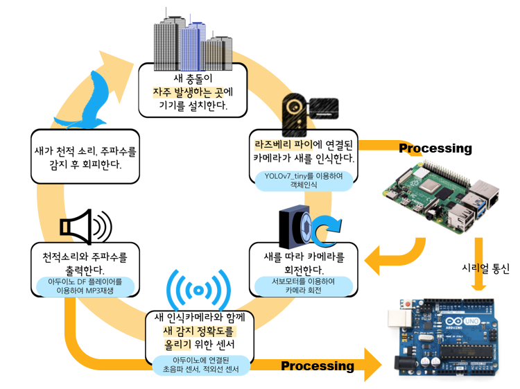
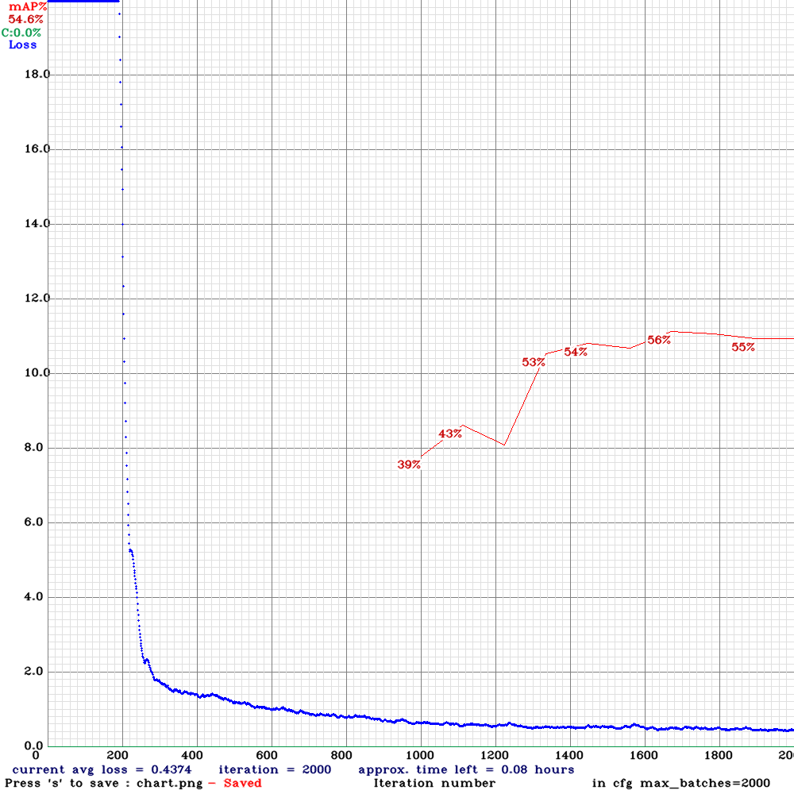
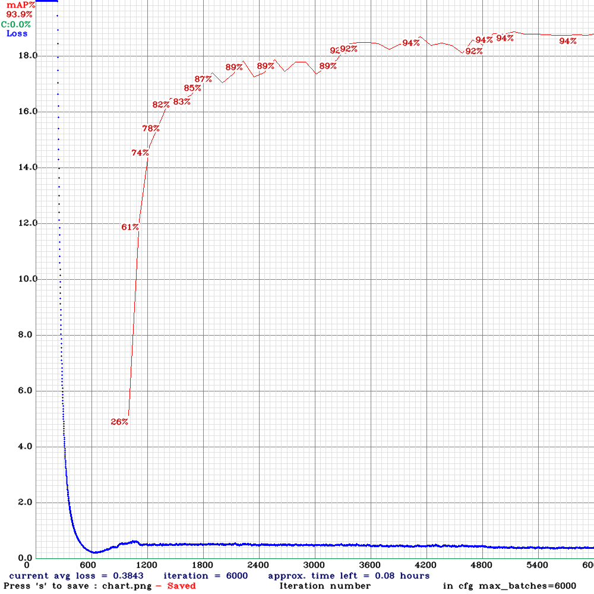
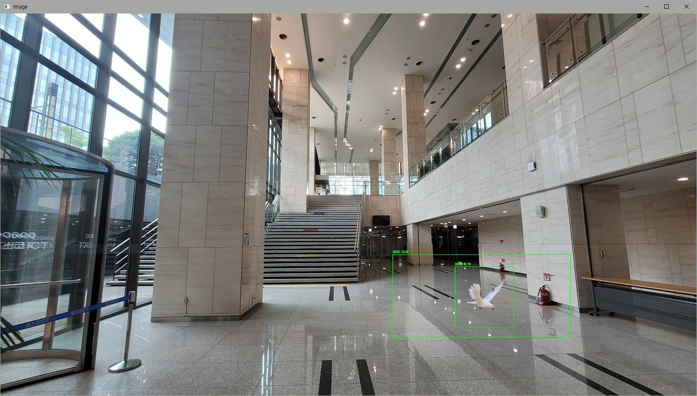

# POSCO AI Youth Challenge · BSZM

카메라와 센서로 새를 감지하고, 카메라 방향을 따라가며 천적 소리·주파수를 출력해 유리창 충돌을 줄이기 위한 프로토타입입니다.

2022년 POSCO AI Youth Challenge에서 제작한 코드와 모델, 학습 결과, 회로도를 하나의 저장소로 정리했습니다. 당시 파일은 `legacy/`에 보존하고 최종 통합 코드 후보는 `src/`에 배치했습니다.

## 확인한 시스템 구조

1. Raspberry Pi 카메라 영상을 OpenCV로 읽습니다.
2. Darknet 형식의 YOLOv7-tiny 설정과 가중치를 OpenCV DNN으로 불러와 새를 탐지합니다.
3. 탐지 위치에 맞춰 서보 모터로 카메라 방향을 조정하도록 설계했습니다.
4. Arduino가 초음파·PIR 센서 또는 Raspberry Pi의 탐지 신호를 받습니다.
5. 조건을 만족하면 DFPlayer Mini로 천적 소리나 주파수를 출력합니다.

시스템 구조도에는 Raspberry Pi와 Arduino 사이의 시리얼 통신도 표시되어 있습니다.



## 실제 기술 구성

| 영역 | 확인된 기술 |
|---|---|
| 영상·AI | Python, OpenCV DNN, NumPy, Darknet 형식 YOLOv7-tiny |
| 하드웨어 제어 | Raspberry Pi 4, Pi Camera, pigpio, RPi.GPIO, 서보 모터 |
| 센서·음원 | Arduino Uno, C/C++, PIR 센서, 초음파 센서, DFPlayer Mini, 스피커 |
| 장치 통신 | PySerial, Arduino Serial |
| 데이터·학습 기록 | YOLO 설정 파일, 학습 가중치, mAP·loss 그래프, 현장 탐지 이미지 |

`Darknet`은 개발 언어가 아니라 학습·모델 프레임워크입니다. 이 자료에서 확인되는 개발 언어는 Python과 Arduino C/C++입니다.

## 폴더 안내

```text
bszm-bird-collision-prevention/
├── README.md
├── src/
│   ├── raspberry_pi/         # 조류 탐지·서보 제어 코드
│   └── arduino/              # 센서·음원 출력 최종 코드
├── model/                    # YOLOv7-tiny cfg, weights, 클래스 이름
├── legacy/                   # YOLOv2/v3와 센서별 시험 코드
├── assets/                   # 학습 그래프, 탐지 결과, 3D 모델링
├── docs/
│   ├── diagrams/             # 시스템 흐름도 및 회로도
│   ├── CODE_INVENTORY.md
│   └── REVIEW_AND_NEXT_STEPS.md
└── requirements.txt
```

## 모델 결과에서 읽을 수 있는 내용

| 기록 | 반복 횟수 | 그래프 표시 mAP | 마지막 표시 평균 loss |
|---|---:|---:|---:|
| YOLOv3-tiny | 2,000 | 54.6% | 0.4374 |
| YOLOv7-tiny | 6,000 | 93.9% | 0.3843 |

그래프상 mAP는 39.3%p 높아졌습니다. 다만 반복 횟수가 다르고, 같은 데이터 분할·평가 조건인지 확인할 파일이 없어 모델 변경만으로 개선됐다고 단정할 수는 없습니다. 현장 탐지 화면에서는 약 50~51% 신뢰도로 새가 검출되어, 학습 평가와 실제 환경 성능 사이의 차이도 확인할 수 있습니다.

| YOLOv3-tiny | YOLOv7-tiny |
|---|---|
|  |  |



## 실행 전에 필요한 파일과 환경

정리된 코드만으로는 즉시 실행되지 않습니다. 다음 항목을 먼저 보완해야 합니다.

- Raspberry Pi OS에서 OpenCV, NumPy, PySerial, pigpio, RPi.GPIO 설치
- Arduino IDE에서 `DFRobotDFPlayerMini`와 `SoftwareSerial` 사용 준비
- `model/obj.names`가 실제 학습 클래스와 일치하는지 확인
- Raspberry Pi와 Arduino의 시리얼 포트 및 통신 코드를 실제 연결에 맞게 활성화
- 카메라 장치 번호와 GPIO 핀 번호 확인

코드에서 확인된 실행 장애와 수정 우선순위는 [REVIEW_AND_NEXT_STEPS.md](docs/REVIEW_AND_NEXT_STEPS.md)에 정리했습니다. Raspberry Pi 코드는 저장소의 `model/` 경로를 사용하도록 정리했고, 실행되지 않던 서보 호출 조건도 바로잡았습니다.

## 포트폴리오에서 강조할 근거

- YOLOv3-tiny 결과를 기준선으로 두고 YOLOv7-tiny 학습 결과와 비교한 과정
- 카메라 데이터 수집부터 탐지 모델, 서보 추적, 센서 보완, 음원 출력까지 이어지는 전체 시스템 구현
- 실내·현장 환경에서 탐지 신뢰도가 낮아지는 문제를 확인한 점
- AI 모델의 수치와 실제 하드웨어 동작을 함께 검증한 경험

포트폴리오에는 “mAP 54.6%에서 93.9%로 향상”이라고만 쓰기보다, **학습 조건이 달라 단순 비교에 한계가 있으며 현장 신뢰도 약 50%를 확인했다**는 내용까지 함께 적는 편이 데이터 분석 직무에 더 설득력 있습니다.

